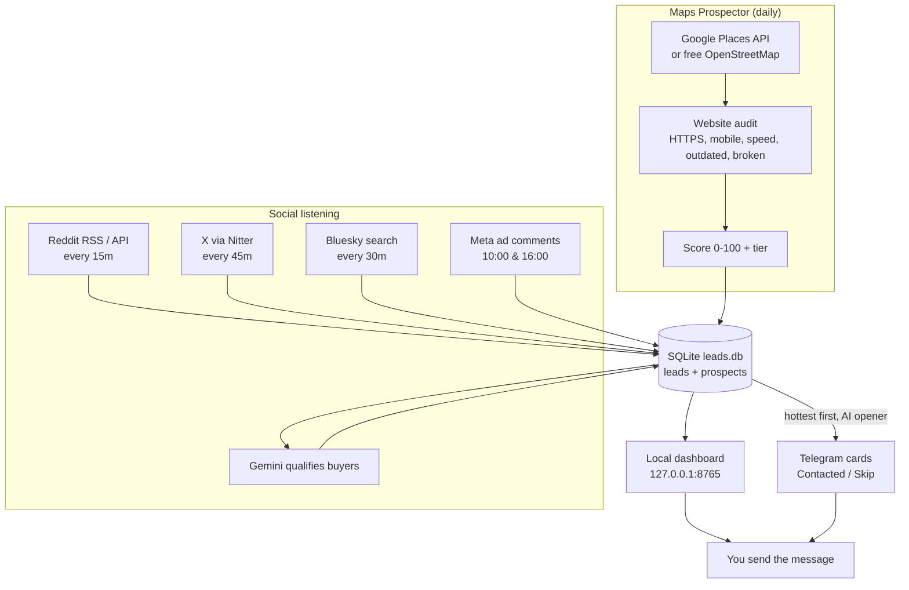

# SynexLabs Lead Engine

A human-in-the-loop lead engine for **SynexLabs** (custom websites, web apps, AI agents). It finds clients two ways:

1. **Maps Prospector.** Finds local businesses with **no website, a social page instead of a site, a broken site, or a weak site**, audits their website, scores each business 0 to 100, and drafts a first message grounded in what it found.
2. **Social intent listening.** Watches Reddit, X, Bluesky and Meta ad comments for people asking for a website or developer, and has **Google Gemini** keep only genuine buyers and draft an icebreaker.

Then it takes care of the busywork: one-tap WhatsApp and email with the message already typed, follow-ups on day 3, 7 and 14, an inbox watcher that sorts replies and drafts answers, a private **audit page and demo homepage** for each prospect, pre-call briefs, proposals, and a pipeline board. It learns which niches and cities reply and searches those first.

Everything lands in a **local dashboard** and in **Telegram**. **First messages always need your tap.** After you email someone, email follow-ups can go out on their own (`EMAIL_AUTO_FOLLOWUPS`). WhatsApp, Instagram and calls are always sent by you.

---

## ▶ Start it (desktop shortcut)

Double-click **Synex Lead Engine** on the desktop.

- The engine starts in the background (no window) and the dashboard opens at `http://127.0.0.1:8765/`.
- **Closing the browser does not stop it.** Scans and Telegram alerts keep running.
- Double-click the shortcut again any time to reopen the dashboard.
- To turn it off: **Stop engine** in the dashboard, or `python main.py stop`.
- Logs: `data/engine.log`.

To recreate the shortcut (new machine, moved folder), or to start the engine automatically at Windows login (quietly, no browser tab):

```powershell
powershell -ExecutionPolicy Bypass -File ".\install_shortcut.ps1"
powershell -ExecutionPolicy Bypass -File ".\install_shortcut.ps1" -Autostart
powershell -ExecutionPolicy Bypass -File ".\install_shortcut.ps1" -RemoveAutostart
```

### Dashboard tabs

| Tab | What you do there |
| :--- | :--- |
| **Prospects** | WhatsApp / Send email / Call buttons with the opener pre-typed (tapping marks them contacted), audit + demo pages, publish |
| **Follow-ups** | Due follow-ups with the message pre-typed; Sent, Replied or Stop |
| **Inbox** | Replies sorted by Gemini (interested, question, not now, ...) with an editable drafted answer and Send reply |
| **Social & website** | Reddit / X / Bluesky leads and website contact-form briefs with drafted replies |
| **Pipeline** | Board from Contacted to Won; brief and proposal buttons |
| **Insights** | Reply rate per niche and city, next searches, email volume |

---

## 🤖 Outreach automation

| Job | When | What it does |
| :--- | :--- | :--- |
| Follow-ups | hourly | Emails due follow-ups automatically for leads first contacted by email (during `EMAIL_SEND_HOURS`, within the warm-up cap). Others become Telegram cards. Unanswered after the last one: **No response**. |
| Inbox check | every 10 min | Read-only IMAP. Matches replies to prospects, labels them with Gemini, stops follow-ups, drafts an answer, pings Telegram for real replies. Unsubscribes go on a do-not-contact list; out-of-office pushes the next follow-up by 5 days; bounces mark the address. Website briefs ("New brief: ...") become leads with a drafted reply. Unrelated mail is ignored and never stored. |
| Morning digest | 09:45 | One Telegram message: prospects waiting, follow-ups to send, replies, pipeline, problems. Then a card per manual follow-up. Missed (PC off)? It catches up at startup. |
| Pages | after the prospector | Audit + demo pages for the hottest prospects, plus a screenshot design check of a few "fine" sites (a dated look can turn them into leads). |
| Health | hourly | Telegram alert when Gemini fails, Places budget is under 20%, or a job fails 3 times in a row. |
| Backup | startup + 13:15 | Copies `leads.db` to `data/backups/` (keeps 14). |

### Email setup (optional, recommended for Switzerland / Australia)

1. Buy a second domain (e.g. `synexlabs-studio.com`) and a mailbox on it (Zoho Mail, Google Workspace).
2. Set up SPF, DKIM and DMARC for that domain (your mail provider shows the DNS records).
3. Fill in `SMTP_*`, `EMAIL_*` and `IMAP_*` in `.env`. Start with the warm-up defaults (5 per day, +2 per day, max 20).

Every cold email has your sign-off, optional postal address, an unsubscribe line and a `List-Unsubscribe` header. Replies to people who wrote back don't count toward the cap.

**Per market:** India and the UAE are WhatsApp-first (one tap, you send). Australia's Spam Act allows business email only where the address is published and the message is relevant to their business; Switzerland's UWG is stricter about unsolicited email, so prefer phone or WhatsApp there unless they engaged first. Keep first touches manual.

---

## 🖼 Audit and demo pages

For each hot prospect the engine builds, in `data/pages/<slug>/`:

- **demo.html**: a concept homepage with their name, city, rating and services, in a palette for their niche. A banner always says it is a concept preview by Synex Labs, not their official site. No invented reviews or facts.
- **audit.html** (if they have a site): laptop + phone screenshots, speed, HTTPS, mobile, Gemini design notes, and how you would fix each problem.

**Publish** copies them to the website's `public/p/<slug>/` (proposals never leave your PC). Deploy the site and the engine notices the pages are live, then adds the link to follow-ups. Pages are `noindex` and `/p/` is disallowed in `robots.ts`.

## 💼 Briefs and proposals

- **Call booked** (Telegram or dashboard) generates a pre-call brief: summary, talking points, questions, suggested package.
- **Make proposal** builds a printable proposal (Save as PDF) from your packages in `src/data/packages.ts`, priced in INR for India and USD elsewhere.

## 📈 Self-tuning

Untried niche + city pairs are searched first. After that, the prospector prefers the pairs, niches and cities with the best reply rate (with a cautious prior so a lucky reply doesn't dominate). See it on the **Insights** tab.

---

## 🏛 Architecture



---

## 🎯 Who comes first

Everything (dashboard order, Telegram cards, search order, social lead tagging) follows this order:

1. **Businesses with no website at all** (a Facebook or Instagram page counts as none). Opening-soon listings, few Google reviews or newly mapped places rank a little higher.
2. **Businesses with years-old or not mobile-friendly websites** to upgrade (no responsive layout, footer year 4+ years old, Flash, very old WordPress). These count even when the other checks pass.
3. Everything else: broken links, slow but modern sites.

**India first** inside each group (`PRIORITY_COUNTRY_CODE=91`), and Indian cities are searched before others. Gemini tags social leads and website briefs with country, "no website yet" and "old website", and they are sorted the same way. The dashboard has **No website** and **Old website** filters.

## 🗺 Maps Prospector

For every niche + city pair (e.g. `dentist` in `Austin, TX`) it:

1. Pulls businesses from **Google Places** (or **OpenStreetMap** when no Google key is set).
2. Audits each website with plain HTTP requests (low RAM, no browser): HTTPS, mobile viewport, load time, footer copyright year, outdated WordPress or jQuery, Flash, free-builder subdomain, dead `business.site` link, 404 or down. With a Google key it also gets the **PageSpeed mobile score**. It collects emails and social links from the site.
3. Scores and tiers each business:

| Tier | Meaning | Heat |
| :--- | :--- | :--- |
| `no_website` | Google listing has no website | 85 to 100 |
| `broken_website` | Site down, 404, or dead Google Business site | 78 to 93 |
| `social_only` | "Website" is a Facebook / Instagram / Linktree page | 80 to 93 |
| `weak_website` | Several audit problems (score at or above `PROSPECT_MIN_SCORE`) | 40 to 100 |
| `no_website_unverified` | OpenStreetMap has no website tag (often just unmapped; check Google first) | 45 to 55 |
| `ok_website` / `unchecked` | Fine, or blocks automated checks. Not alerted. | 0 |

4. Sends the hottest `PROSPECT_ALERTS_PER_RUN` to Telegram with a Gemini-written opener (falls back to a plain template if Gemini is unavailable). The dashboard's **Write with AI** button drafts one on demand.

Each niche + city is searched again only after `PROSPECT_RERUN_DAYS`, so paid calls are not repeated.

### Google Places setup (recommended)

1. Open [console.cloud.google.com](https://console.cloud.google.com/), create a project, add a billing account.
2. Enable **Places API (New)** and **PageSpeed Insights API**.
3. Create an API key (restrict it to those two APIs) and set `GOOGLE_PLACES_API_KEY` in `.env`.

Text Search with website and phone fields bills on Google's *Enterprise* SKU: **1,000 free calls per month**, each returning up to 20 businesses. The engine stops at `PLACES_MONTHLY_CALL_LIMIT` (default 900) so it stays inside the free allowance. Check Google's current pricing before raising it.

Without a key the prospector uses OpenStreetMap. It is free, but website data is incomplete and the public Overpass servers are often overloaded, so some runs fail and retry later.

### Targets

```ini
PROSPECT_NICHES=dentist,hair salon,restaurant,real estate agent,plumber,gym,clinic,lawyer
PROSPECT_CITIES=Austin, TX;Pune, India;Dubai
```

Cities are separated by **semicolons**. Google accepts any niche text; OpenStreetMap needs a tag mapping (see `OSM_NICHE_TAGS` in `prospector/sources.py`).

---

## 💬 Social listening

- **Reddit:** public RSS for the subreddits in `REDDIT_SUBREDDITS`. Reddit now rate limits unauthenticated access and blocks anonymous search. Official API credentials need approval under Reddit's Responsible Builder Policy.
- **X / Twitter:** Nitter mirrors (often down). The Chrome fallback only runs after `python main.py twitter-login`, so it never launches a browser for nothing.
- **Bluesky:** official search API with an app password (`BLUESKY_HANDLE`, `BLUESKY_APP_PASSWORD`).
- **Meta:** ad comment scraping after `python main.py meta-login`.

**No silent fallback:** if Gemini is missing or out of quota, posts stay *pending* and are retried next cycle. The engine never guesses a lead decision without the model.

---

## ⚡ Setup

```powershell
cd "Lead generator"
python -m venv .venv
.\.venv\Scripts\Activate.ps1
pip install -r requirements.txt
copy .env.example .env   # then fill in the keys
powershell -ExecutionPolicy Bypass -File ".\install_shortcut.ps1"
```

Minimum `.env`: `GEMINI_API_KEY`, `TELEGRAM_BOT_TOKEN`, `TELEGRAM_CHAT_ID`. Add `GOOGLE_PLACES_API_KEY` for the best prospects.

---

## 🛠 CLI Commands

| Command | Action |
| :--- | :--- |
| `python main.py start` | Background engine + dashboard (what the desktop shortcut runs). `--no-browser` to skip opening it |
| `python main.py stop` | Stops the background engine |
| `python main.py schedule` | Same jobs in the foreground terminal (Ctrl+C to stop) |
| `python main.py prospect` | One prospecting pass over due niche + city searches |
| `python main.py prospect --niche "dentist,gym" --city "Austin, TX" --limit 2 --no-alert` | Targeted pass, save only |
| `python main.py show-prospects [--status all]` | Hottest saved prospects in a terminal table |
| `python main.py export-prospects [--out file.csv]` | CSV call list (`data/prospects.csv` by default) |
| `python main.py audit-site --url https://example.com` | Audit one website (handy before a sales call) |
| `python main.py build-pages` | Audit + demo pages for the hottest prospects now |
| `python main.py run-followups` | Send due email follow-ups / mark no-response now |
| `python main.py check-inbox` | Process new replies and website briefs now |
| `python main.py send-digest` | Send the morning digest now (prints it if Telegram is off) |
| `python main.py backup` | Back up the database now |
| `python main.py run-once` | One social scan across active platforms |
| `python main.py ingest-reddit` / `ingest-twitter` / `ingest-bluesky` / `ingest-meta` | One platform only |
| `python main.py show-leads` | Qualified social leads |
| `python main.py test-ai` / `test-telegram` | Connectivity checks |
| `python main.py meta-login` / `twitter-login` | Save browser cookies once |

---

## 🔒 Safety

- Official APIs and public feeds only; no scraping of Google Maps, LinkedIn or Facebook groups.
- Human pacing and jitter on every scraper; X / Meta browsers only with saved logins.
- First messages always need your tap. WhatsApp, Instagram and calls are always sent by you; only email follow-ups (after you emailed someone) and replies you approve are sent by the engine, within the warm-up cap.
- The inbox watcher opens the mailbox read-only and only stores mail that belongs to your outreach.
- Dashboard listens on `127.0.0.1` only, requires a per-session token on every API call, checks the `Host` header (blocks DNS rebinding) and sends a strict Content-Security-Policy. Scraped text is rendered as plain text, never HTML.
- If you add cold email: use a separate sending domain, include an unsubscribe line and your business address (CAN-SPAM), and be careful with sole traders in the UK / EU.

---

## 📂 Folder Structure

```
Lead generator/
├── assets/synex-leads.ico     # Shortcut + dashboard icon
├── brain/                     # Gemini analyzer + prompts (lead qualification, prospect openers)
├── config/                    # settings.py (all .env options), keywords.py
├── dashboard/                 # Local dashboard server + static UI
├── database/                  # SQLite schema, LeadRepository, ProspectRepository
├── delivery/                  # Telegram cards + button listener
├── ingestion/                 # Reddit, X, Bluesky, Meta scrapers
├── outreach/                  # Contact links, messages, email sender, inbox watcher, follow-ups, digest, health
├── prospector/                # Places / OSM sources, website audit, scoring, engine
├── sales/                     # Packages (from the website), pre-call briefs, proposals
├── showcase/                  # Screenshots, audit + demo page templates, publish, live check
├── scheduler/job_runner.py    # EngineService: all background jobs
├── install_shortcut.ps1       # Creates the desktop shortcut
├── main.py                    # CLI entrypoint
└── data/                      # leads.db, engine.log (gitignored)
```
