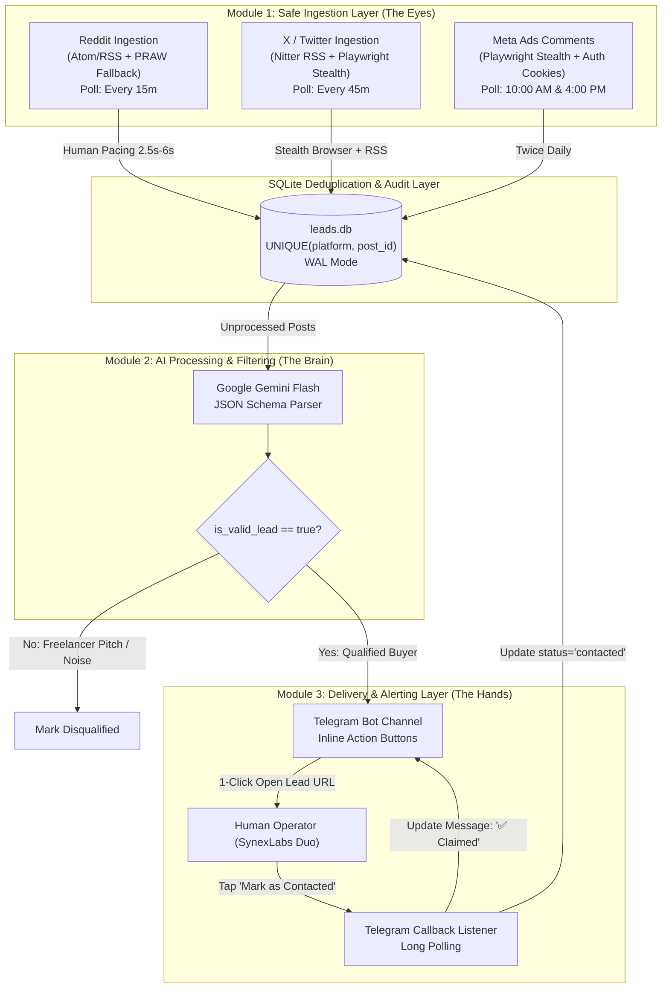

# SynexLabs Intent Ingestion Engine

A fully automated, human-in-the-loop lead intelligence engine built for **SynexLabs** (technical duo specializing in custom websites, AI agents, and web applications). It monitors social platforms (Reddit, X/Twitter, Meta Ads) for high-intent client inquiries, filters out 90% spam using **Google Gemini Flash (Free Tier)**, crafts contextual 2-sentence icebreaker DMs, and routes qualified leads directly to Telegram with interactive action buttons and zero risk of account bans.

---

## 🏛 System Architecture



---

## 🔒 Anti-Bot Safety & Zero-Cost Constraints

1. **Zero-Cost Policy**:
   - **Reddit**: Ingests via public Atom/RSS feeds with rotating browser headers, avoiding Reddit's paid API tier and 403 blocks. Supports free PRAW OAuth script applications.
   - **X / Twitter**: Ingests via Nitter search syndication with stealth Playwright Chrome fallback.
   - **Meta Ads**: Playwright with saved authentication cookies visiting 5-10 target competitor ads.
   - **AI Brain**: Uses **Google Gemini 2.5/1.5 Flash (Free Tier)** with 15 RPM / 1,500 requests per day.
   - **Database**: Local embedded **SQLite** with Write-Ahead Logging (`WAL` mode).
   - **Telegram**: Free Telegram Bot API long-polling without needing paid webhooks, public IP, or ngrok.

2. **Anti-Ban Protections**:
   - **No Headless Aggression**: Playwright scripts use `playwright-stealth` with native Chrome executable.
   - **Human Pacing**: Every navigation includes randomized delays (`random.uniform(2.5, 6.0)`).
   - **Staggered Cron Scheduling**: APScheduler applies up to 60s randomized jitter so ingestion is never clock-synchronous.
   - **No Auto-DMs**: The system *never* sends automated direct messages to users on platforms. All outreach is human-in-the-loop via pre-generated founder icebreakers.

---

## 📂 Modular Folder Structure

```
Lead generator/
├── config/
│   ├── __init__.py
│   ├── settings.py           # Configuration, paths, search queries, pacing
│   └── keywords.py           # High-intent phrases & negative noise filters
├── database/
│   ├── __init__.py
│   ├── db.py                 # SQLite WAL connection manager
│   ├── schema.sql            # Table definitions, unique indexes, audit logging
│   └── repository.py         # LeadRepository (O(1) dedup checks, CRUD, pipeline metrics)
├── brain/
│   ├── __init__.py
│   ├── gemini_analyzer.py    # Google Gemini Flash parser with structured JSON output
│   └── prompts.py            # SynexLabs prompt engineering (buyer vs freelancer pitch)
├── ingestion/
│   ├── __init__.py
│   ├── base.py               # BaseScraper with human pacing & rotating browser headers
│   ├── reddit_scraper.py     # Multi-strategy Reddit ingestion (RSS/Atom + PRAW + JSON)
│   ├── twitter_scraper.py    # Twitter/X scraper (Nitter RSS + Playwright stealth)
│   └── meta_scraper.py       # Meta Ads comment scraper with cookie session support
├── delivery/
│   ├── __init__.py
│   ├── telegram_bot.py       # Telegram lead dispatcher with inline buttons
│   └── telegram_listener.py  # 2-way callback listener for [Mark as Contacted]
├── scheduler/
│   ├── __init__.py
│   └── job_runner.py         # APScheduler cron with anti-ban jitter
├── auth_state/               # Saved session cookies for Meta / X (gitignored)
├── data/                     # Local SQLite leads.db directory (gitignored)
├── .env.example              # Environment variables template
├── requirements.txt          # Minimal Python dependencies
├── pipeline.py               # Multi-platform pipeline orchestrator
├── main.py                   # Unified CLI entrypoint
└── README.md
```

---

## ⚡ Quickstart

### 1. Environment Setup
```bash
cd "Lead generator"

# Windows PowerShell:
.\.venv\Scripts\Activate.ps1

# Linux / WSL2 / macOS:
# source .venv/bin/activate

# Install dependencies
pip install -r requirements.txt
```

### 2. Configure Environment Variables
Copy `.env.example` to `.env`:
```bash
cp .env.example .env
```
Add your free keys:
```ini
# Google AI Studio (Free Tier)
GEMINI_API_KEY=AIzaSy...
GEMINI_MODEL=gemini-2.5-flash

# Telegram Bot (via @BotFather)
TELEGRAM_BOT_TOKEN=123456789:ABCdef...
TELEGRAM_CHAT_ID=-100xxxxxxxxxx
```

### 3. One-Time Cookie Setup (Optional for Meta & X)
To allow the headless browser to access Facebook Ads or live X searches without login prompts:
```bash
# Opens a visible Chrome window to log into Meta once:
python main.py meta-login

# Opens a visible Chrome window to log into X once:
python main.py twitter-login
```
*Cookies are securely saved to `auth_state/meta_cookies.json` and `auth_state/twitter_cookies.json` (gitignored).*

---

## 🛠 CLI Commands

| Command | Action |
| :--- | :--- |
| `python main.py run-once` | Runs one complete ingestion cycle across active platforms, qualifies leads with Gemini, and dispatches to Telegram |
| `python main.py ingest-reddit` | Runs Reddit ingestion only |
| `python main.py ingest-twitter` | Runs Twitter/X search ingestion only |
| `python main.py ingest-meta` | Runs Meta competitor ad comment ingestion only |
| `python main.py show-leads` | Displays all stored qualified buyer leads in a clean terminal table |
| `python main.py schedule` | Starts continuous multi-platform APScheduler + interactive Telegram listener |
| `python main.py test-ai` | Tests Gemini Flash API connectivity with sample client data |
| `python main.py test-telegram` | Dispatches a test lead card to your Telegram channel |

---

## 📱 Telegram Lead Card Example

When Gemini flags `is_valid_lead: true`, a card is sent to your Telegram channel:

```
🔥 NEW HIGH-INTENT LEAD DETECTED

Platform: Reddit (r/ecommerce)
Category: E-commerce Build & Speed Optimization
Estimated Budget: High ($5k - $8k)
Author: u/boutique_founder

Title: Need an agency to rebuild our e-commerce store with custom design & high speed

💡 Drafted Icebreaker:
"Hey! Saw you're dealing with a 4s+ load time and low conversions on your apparel store. At SynexLabs we specialize in headless high-speed e-commerce and would love to show you a couple of quick asset optimization wins you can implement today."

[🔗 Open Lead Post]    [✅ Mark as Contacted]
```

When you click **[✅ Mark as Contacted]**, the bot instantly updates SQLite to `status='contacted'` and changes the button to `[✅ Claimed by Founder]`, preventing duplicate outreach between teammates!
